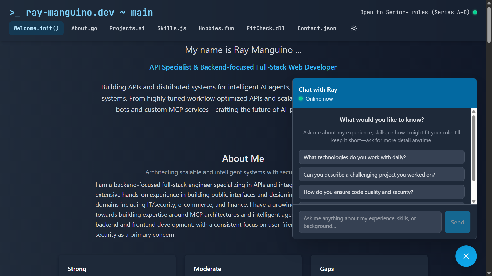
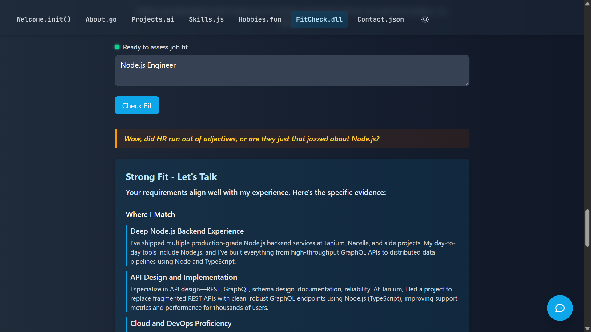
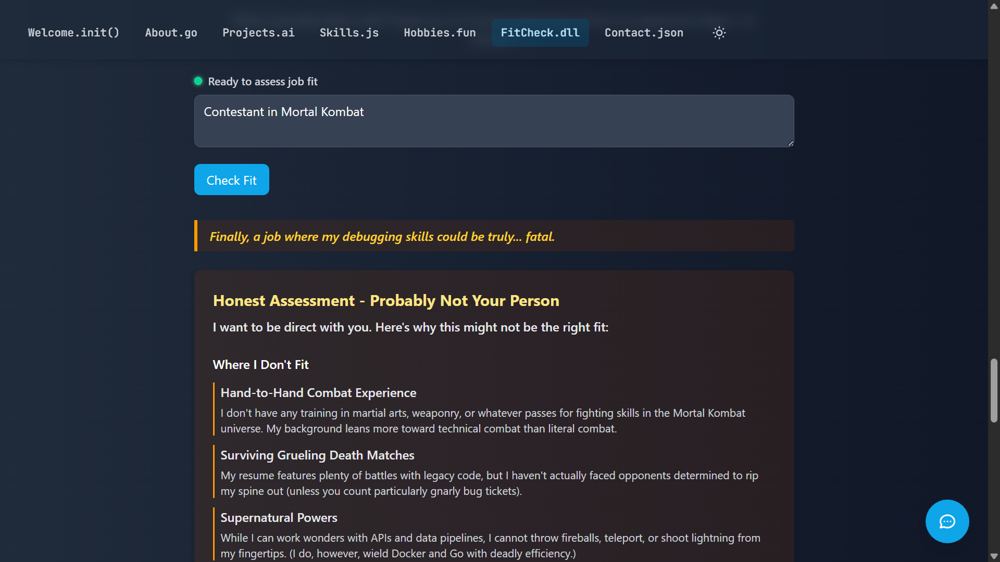

# Six7SWE - Personal Portfolio & Job Hunter

Six7SWE is a monorepo containing **two products** that share one backend
process, one PostgreSQL database and one AI client:

- **Portfolio** — a public personal site with an AI chat assistant, a job
  match score and a fit assessment.
- **Job Hunter** — a signed-in tool that scrapes job postings and scores them
  against search profiles.

The two are separated by an explicit boundary: their own tables, their own
route namespaces (`/` vs `/job-hunt/*`) and their own frontend route groups
(`/` vs `/hunter/*`). They share exactly one piece of business logic — the
canonical job matcher.

  
  
  

## Monorepo Structure

- `backend/` - Fastify + TypeScript API for both products, backed by Supabase
  (PostgreSQL) and Drizzle ORM.
- `frontend/` - Vite + React + TypeScript app serving the public portfolio and
  the signed-in job-hunter.
- `docs/architecture.md` - How the two products fit together, and where the
  boundary sits.

## Prerequisites

- Node.js (LTS) and `pnpm` installed globally
- Supabase CLI for managing the local PostgreSQL instance
- Docker Desktop (the Supabase CLI runs Postgres in a container)
- (Optional) Railway account for hosting the frontend

## Portfolio (public)

The public site at `/`:

- Landing page with highlights, achievements, projects and skills
- Job match score — paste a job description for a 0-100 score, matching skills
  and gaps
- Honest fit assessment — a first-person fit assessment for a role
- Contact page with contact info and a message form
- AI chat assistant answering questions about professional background

## Job Hunter (signed in)

The tool at `/hunter`:

- Sign in with Supabase Auth
- Create and edit search profiles (keywords, LinkedIn geo id, resume text)
- Start a job refresh and watch it progress
- Review scored matches with score, band and reasoning

## Local Setup

For full local setup instructions (environment, dependencies, seeding, and dev
servers), see `SETUP.md`.

## Deployment

For Railway deployment instructions and production configuration, see
`DEPLOYMENT.md`.
