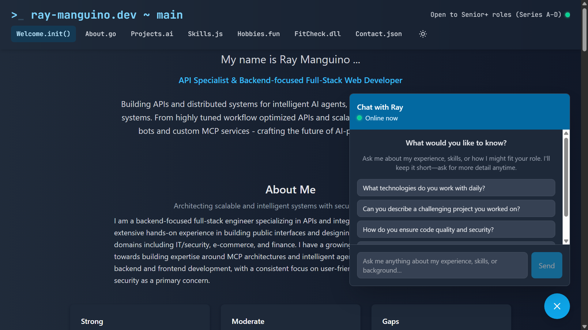
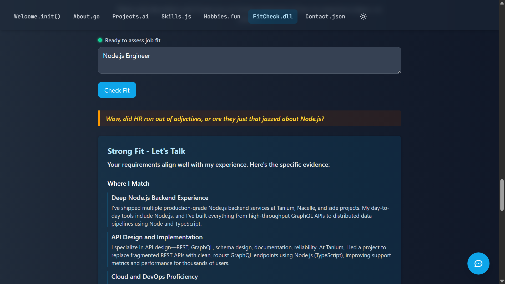
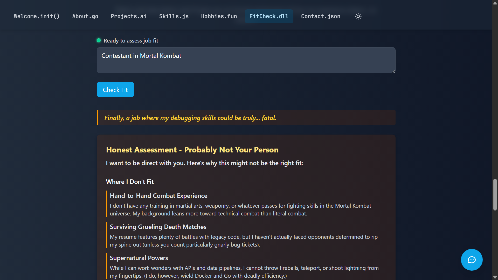

# Six7SWE - Personal Portfolio & Job Hunter

Six7SWE is a monorepo containing **two products** that share one backend
process and one AI client, plus a knowledge service that holds the owner's
background:

- **Portfolio** — a public personal site with an AI chat assistant and a fit
  assessment.
- **Job Hunter** — a signed-in tool that scrapes job postings and scores them
  against search profiles.

The two are separated by an explicit boundary: their own route namespaces (`/` vs `/job-hunt/*`) and their own frontend route groups
(`/` vs `/hunter/*`). Only the job hunter has PostgreSQL tables. They share
exactly one piece of business logic — the canonical job matcher — and one
source of background: retrieval over the documents in the knowledge service.

  
  
  

## Monorepo Structure

- `backend/` - Fastify + TypeScript API for both products. The job hunter's
  tables are in Supabase (PostgreSQL) through Drizzle ORM.
- `knowledge/` - The knowledge service: the owner's resumes and supporting
  documents, with vector retrieval (pgvector) for chat, the fit check and the
  job matcher; see `knowledge/README.md`.
- `packages/knowledge-types/` - The knowledge wire contract shared by the
  backend and the knowledge service.
- `frontend/` - Vite + React + TypeScript app serving the public portfolio and
  the signed-in job-hunter.
- `api/` - [Bruno](https://www.usebruno.com/) collections with an example for
  every route of the backend and the knowledge service; see `api/README.md`.
- `docs/architecture.md` - How the two products fit together, and where the
  boundary sits.

## Prerequisites

- Node.js (LTS) and `pnpm` installed globally
- Supabase CLI for managing the local PostgreSQL instance
- Docker Desktop (the Supabase CLI runs Postgres in a container)
- (Optional) Railway account for hosting the frontend

## Portfolio (public)

The public site at `/`:

- Landing page with highlights, achievements, projects and skills
- Honest fit assessment — a first-person fit assessment for a role, grounded
  in the background documents most relevant to the job description
- Contact page with contact info and a message form
- AI chat assistant answering questions about professional background from the
  documents retrieved for each question

## Job Hunter (signed in)

The tool at `/hunter`:

- Sign in with Supabase Auth
- Create and edit search profiles (keywords, LinkedIn geo id, notes)
- Start a job refresh and watch it progress
- Review scored matches with score, band and reasoning

## Local Setup

For full local setup instructions (environment, dependencies, seeding, and dev
servers), see `SETUP.md`.

## Deployment

For Railway deployment instructions and production configuration, see
`DEPLOYMENT.md`.
