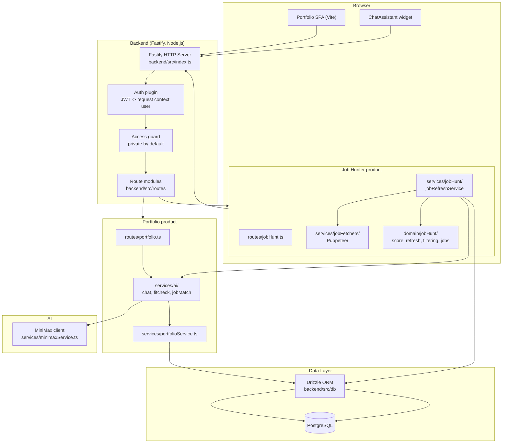
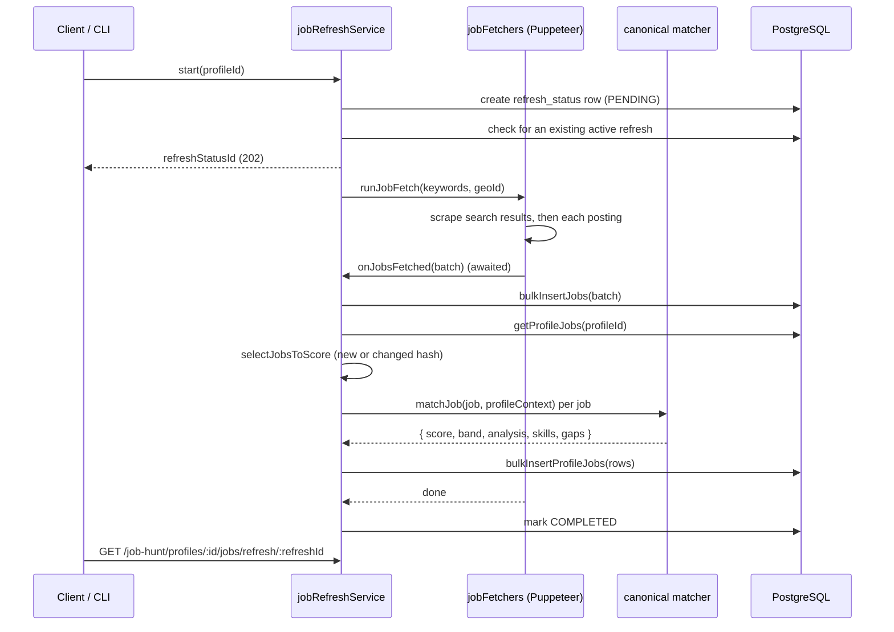

# System Architecture

Six7SWE contains **two products** that share one backend process, one PostgreSQL
database and one AI client, but are kept apart by an explicit boundary.

- **Portfolio** — the public personal site and its AI assistant. Read-only for
  visitors, no authentication.
- **Job Hunter** — a signed-in tool for scraping job postings and scoring them
  against search profiles. Everything it exposes lives under `/job-hunt/*` and
  requires authentication.

The two share exactly one piece of business logic: the canonical job matcher.
Everything else — schema, routes, services, tables — is product-specific.

## High-Level Overview



## The boundary

The boundary is expressed in four places, and all four are checked by tests or
by the compiler.

| Boundary | Where |
|---|---|
| Database tables | `backend/src/db/schema/portfolio.ts` and `backend/src/db/schema/jobHunt.ts` |
| HTTP surface | `/job-hunt/*` vs the public portfolio paths |
| Services | `backend/src/services/ai/` (shared) vs `backend/src/services/jobHunt/` and `backend/src/services/jobFetchers/` |
| Frontend | `/` (public) vs `/hunter/*` (signed in) |

There is no query that joins the two table families, and no service that both
products call except the AI client.

## Authentication & Authorization

Routes are **private by default**. Each route declares whether it is public via
the `public` route config (`backend/src/routes/access.ts`), and the guard in
`backend/src/index.ts` reads that flag off the registered route. Adding an
endpoint therefore cannot accidentally expose it.

```text
Authorization: Bearer <supabase access token>
        │
        ▼
plugins/auth.ts ──► verifies the JWT against the Supabase JWKS endpoint
        │
        ▼
requestContext user { id, email, authId }
        │
        ▼
routes/access.ts ──► private routes require a real user, else 401
```

The verified identity is linked to a local `users` row through
`users.auth_id`. The row is created on first sign-in. `users.id` stays a serial
because `profiles.user_id` references it.

Every job-hunter query that takes a profile id is scoped by the authenticated
user, so a caller cannot reach another user's profile by guessing an id.

> `AUTH_DEV_BYPASS=true` impersonates the seeded user for local development.
> It is refused when `NODE_ENV=production`.

## Frontend

**Stack & location**

- **Framework**: React 18, TypeScript.
- **Bundler**: Vite.
- **Key files**:
  - `frontend/src/main.tsx` – bootstraps the React app.
  - `frontend/src/App.tsx` – routing; the public portfolio and the job-hunter.
  - `frontend/src/components/ChatAssistant.tsx` – floating chat widget.
  - `frontend/src/contexts/AuthContext.tsx` – Supabase session for the job-hunter.
  - `frontend/src/pages/hunter/` – the job-hunter pages.
  - `frontend/src/utils/api.ts` – API client; attaches the access token.

**Routing**

| Route | Rendering |
|---|---|
| `/` | Portfolio landing page (highlights, projects, skills, job matcher, fit check, contact) |
| `/work`, `/contacts` | Redirects into anchors on `/` |
| `/hunter/login` | Sign in |
| `/hunter/profiles` | Search profile list and creation |
| `/hunter/profiles/:id` | Refresh controls and scored matches |
| `/hunter/profiles/:id/edit` | Profile editor |

**API communication**

`apiRequest(endpoint, options)` builds the URL from `VITE_API_URL`, falling
back to the `/api` proxy prefix, and attaches the current access token when the
auth context has registered one.

## Backend

**Entry point** — `backend/src/index.ts`:

- Loads environment (`dotenv/config`).
- Creates a Fastify instance with pino logging and header redaction.
- Registers CORS, static file serving from `../public` under `/public/`, and
  `@fastify/request-context`.
- Registers the auth plugin, then the service plugins, then the routes.
- Registers a health check at `/` returning only allowlisted env values.
- Marks abandoned refreshes as failed on startup, then listens.

**Route modules**

| Module | Routes |
|---|---|
| `routes/portfolio.ts` | `GET /portfolio`, `GET /resume`, `POST /chat`, `POST /fitcheck`, `POST /contact` |
| `routes/jobHunt.ts` | `/job-hunt/jobs`, `/job-hunt/profiles` (CRUD), `/job-hunt/profiles/:id/jobs`, `/job-hunt/profiles/:id/jobs/refresh[/:refreshId]`, `/job-hunt/users` |

**AI layer** — `backend/src/services/ai/`:

| Module | Purpose |
|---|---|
| `chat.ts` | Chat assistant, grounded in the portfolio |
| `fitcheck.ts` | First-person fit assessment |
| `jobMatch.ts` | **The canonical matcher.** Profile-source agnostic. |

Prompts live in `backend/src/services/ai/prompts/`. `minimaxService.ts` is
transport only: it sends the request, parses the response and applies the
supplied Zod schema. A malformed model response is an error, never a
fabricated result.

## Data Layer

**Schema** — split by product:

| File | Tables |
|---|---|
| `db/schema/portfolio.ts` | `portfolio_profile` (singleton), `content_sections` |
| `db/schema/jobHunt.ts` | `users`, `profiles`, `jobs`, `profile_jobs`, `refresh_status` |

Enums: `job_source`, `refresh_update_status`, `refresh_update_status_step`,
`match_band`.

**Portfolio service & caching** — `backend/src/services/portfolioService.ts`
reads `portfolio_profile` and `content_sections` through Drizzle and caches the
result in memory for `PORTFOLIO_CACHE_TTL_MS` (default 10 minutes).

## Job Refresh Pipeline



The fetch callback is **awaited**, so `COMPLETED` is only written once the
last batch has actually been scored and stored. Any failure marks the refresh
`FAILED` rather than leaving it `IN_PROGRESS`.

Jobs are re-scored when their content hash changed, so an edited posting is not
left with a stale score forever.

## Domain layer

`backend/src/domain/jobHunt/` holds the pure logic, with no IO and no framework
imports:

| Module | Purpose |
|---|---|
| `score.ts` | Score to band thresholds (`scoreBand`) |
| `refresh.ts` | Refresh status state machine |
| `filtering.ts` | Which jobs still need scoring (`selectJobsToScore`) |
| `jobs.ts` | Search query construction and geoId validation |
| `identity.ts` | Which local row an authenticated subject maps to |

## Environment & Configuration

| Variable | Scope | Purpose |
|---|---|---|
| `DATABASE_URL` | backend | PostgreSQL connection string |
| `MINIMAX_API_KEY` | backend | AI provider key |
| `RESEND_API_KEY` | backend | Contact form delivery |
| `RESEND_FROM_EMAIL` | backend | Sender address for outbound mail |
| `RESEND_FROM_NAME` | backend | Display name for the sender (optional) |
| `PORTFOLIO_CACHE_TTL_MS` | backend | Portfolio cache TTL (default 600000) |
| `SUPABASE_URL` | backend | Auth provider; derives the JWKS endpoint |
| `SUPABASE_JWKS_URL` | backend | Explicit JWKS endpoint (optional) |
| `SUPABASE_JWT_SECRET` | backend | Legacy HS256 mode (optional) |
| `AUTH_DEV_BYPASS` | backend | Dev-only user impersonation |
| `JOB_REFRESH_STALE_MINUTES` | backend | Abandoned refresh threshold (default 30) |
| `VITE_API_URL` | frontend | Backend base URL |
| `VITE_SUPABASE_URL` | frontend | Supabase project URL |
| `VITE_SUPABASE_ANON_KEY` | frontend | Supabase anon key |

## Deployment Considerations

- **Local development** — run the backend (`pnpm dev`) and the frontend
  (`pnpm dev`); the Vite dev server proxies `/api` to the backend.
- **Production** — build the frontend to `frontend/dist` and serve it from a
  static host or behind a reverse proxy; deploy the backend to Railway with
  `DATABASE_URL` pointing at Supabase's IPv4 connection string.
- **Refreshes** — schedule `pnpm jobs:refresh -- --profile <id>` as a Railway
  Cron so a refresh survives a process restart. The HTTP trigger remains
  available for manual runs.
