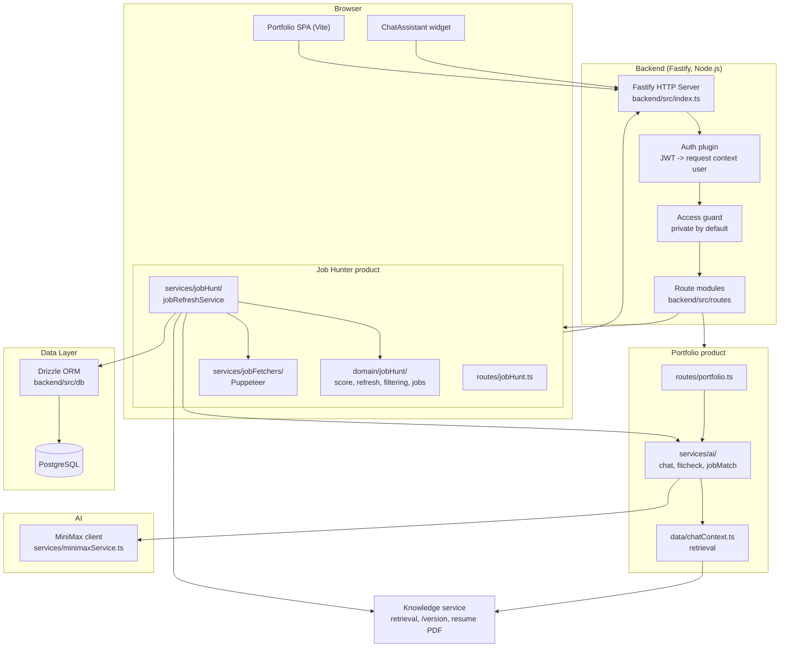
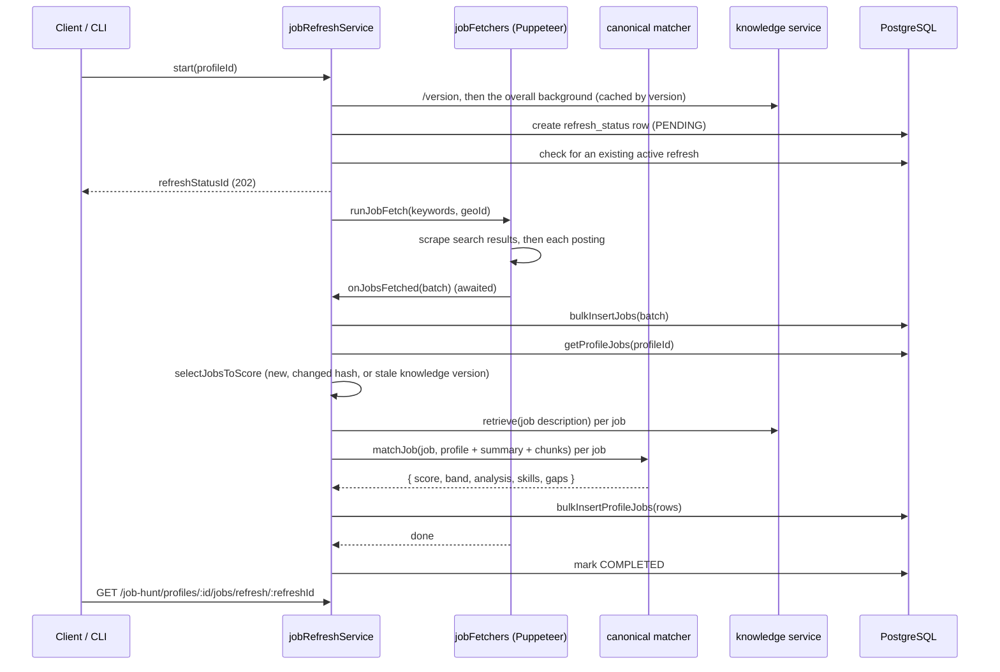

# System Architecture

Six7SWE contains **two products** that share one backend process and one AI
client, but are kept apart by an explicit boundary. Only the job hunter has
PostgreSQL tables; the portfolio's background comes from the knowledge service.

- **Portfolio** — the public personal site and its AI assistant. Read-only for
  visitors, no authentication.
- **Job Hunter** — a signed-in tool for scraping job postings and scoring them
  against search profiles. Everything it exposes lives under `/job-hunt/*` and
  requires authentication.

The two share exactly one piece of business logic: the canonical job matcher.
Everything else — schema, routes, services, tables — is product-specific.

## High-Level Overview



## The boundary

The boundary is expressed in four places, and all four are checked by tests or
by the compiler.

| Boundary | Where |
|---|---|
| Database tables | `backend/src/db/schema/jobHunt.ts` only; the portfolio has none |
| HTTP surface | `/job-hunt/*` vs the public portfolio paths |
| Services | `backend/src/services/ai/` (shared) vs `backend/src/services/jobHunt/` and `backend/src/services/jobFetchers/` |
| Frontend | `/` (public) vs `/hunter/*` (signed in) |

The portfolio never touches the database, and no service is shared by both
products except the AI client and the knowledge-service clients.

## Authentication & Authorization

Routes are **private by default**. Each route declares whether it is public via
the `public` route config (`backend/src/routes/access.ts`), and the guard in
`backend/src/index.ts` reads that flag off the registered route. Adding an
endpoint therefore cannot accidentally expose it.

```text
Authorization: Bearer <supabase access token>
        │
        ▼
plugins/auth.ts ──► verifies the JWT against the Supabase JWKS endpoint
        │
        ▼
requestContext user { id, email, authId }
        │
        ▼
routes/access.ts ──► private routes require a real user, else 401
```

The verified identity is linked to a local `users` row through
`users.auth_id`. The row is created on first sign-in. `users.id` stays a serial
because `profiles.user_id` references it.

Every job-hunter query that takes a profile id is scoped by the authenticated
user, so a caller cannot reach another user's profile by guessing an id.

> `AUTH_DEV_BYPASS=true` impersonates the seeded user for local development.
> It is refused when `NODE_ENV=production`.

## Frontend

**Stack & location**

- **Framework**: React 19, React Router 7, TypeScript.
- **Bundler**: Vite.
- **Key files**:
  - `frontend/src/main.tsx` – bootstraps the React app.
  - `frontend/src/App.tsx` – routing; the public portfolio and the job-hunter.
  - `frontend/src/components/ChatAssistant.tsx` – floating chat widget.
  - `frontend/src/contexts/AuthContext.tsx` – Supabase session for the job-hunter.
  - `frontend/src/pages/hunter/` – the job-hunter pages.
  - `frontend/src/utils/api.ts` – API client; attaches the access token.

**Routing**

| Route | Rendering |
|---|---|
| `/` | Portfolio landing page, rendered from static content in `frontend/src/content/` (highlights, projects, skills, job matcher, fit check, contact) |
| `/work`, `/contacts` | Redirects into anchors on `/` |
| `/hunter/login` | Sign in |
| `/hunter/profiles` | Search profile list and creation |
| `/hunter/profiles/:id` | Refresh controls and scored matches |
| `/hunter/profiles/:id/edit` | Profile editor |
| `/hunter/knowledge` | Knowledge base (owner only): upload, risk review, documents, text preview, "ask as a visitor" playground, eval set |

**API communication**

`apiRequest(endpoint, options)` builds the URL from `VITE_API_URL`, falling
back to the `/api` proxy prefix, and attaches the current access token when the
auth context has registered one.

## Backend

**Entry point** — `backend/src/index.ts`:

- Loads environment (`dotenv/config`).
- Creates a Fastify instance with pino logging and header redaction.
- Registers CORS, static file serving from `../public` under `/public/`, and
  `@fastify/request-context`.
- Registers the auth plugin, then the service plugins, then the routes.
- Registers a health check at `/` returning only allowlisted env values.
- Marks abandoned refreshes as failed on startup, then listens.

**Route modules**

| Module | Routes |
|---|---|
| `routes/portfolio.ts` | `GET /resume` (the knowledge service primary resume, cached by corpus version), `POST /chat`, `POST /fitcheck`, `POST /contact` (to `CONTACT_TO_EMAIL`), and the public MCP server below (`routes/publicMcp.ts`) |
| `routes/jobHunt.ts` | `/job-hunt/jobs`, `/job-hunt/profiles` (CRUD), `/job-hunt/profiles/:id/jobs`, `/job-hunt/profiles/:id/jobs/refresh[/:refreshId]`, `/job-hunt/users` |
| `routes/knowledge.ts` | `GET /knowledge/access`; owner only: `/knowledge/documents` (list, upload, get, text, primary, delete), `POST /knowledge/search` |

**AI layer** — `backend/src/services/ai/`:

| Module | Purpose |
|---|---|
| `chat.ts` | Chat assistant, grounded in the chunks retrieved for each question |
| `fitcheck.ts` | First-person fit assessment, grounded in the chunks retrieved for the job description |
| `jobMatch.ts` | **The canonical matcher.** Profile-source agnostic. |

Prompts live in `backend/src/services/ai/prompts/`. `minimaxService.ts` is
transport only: it sends the request, parses the response and applies the
supplied Zod schema. A malformed model response is an error, never a
fabricated result.

**Public MCP server** — `POST /mcp/public` (#205; `routes/publicMcp.ts`,
`services/publicMcp/`). A stateless streamable-HTTP MCP endpoint that anyone's
MCP client can use, with no key, so a prospective employer's AI can query the
owner's background directly. It is not the knowledge service's `/mcp`, which
stays the owner's private server; the knowledge service keeps no public
domain. Add it to Claude Code with:

```sh
claude mcp add --transport http six7swe https://<backend-host>/mcp/public
```

- **Tools**, both `readOnlyHint: true`: `search_background { query, k? }`
  (`/retrieve` through the backend's retrieval client; `k` defaults to 6, at
  most 8; returns each chunk's source file, heading, content and similarity)
  and `get_resume_pdf` (the same cached PDF `/resume` serves, as an embedded
  `application/pdf` resource; a tool error when there is none or it is over
  5 MB). Everything uploaded is meant to be public, and the risk scan (#212)
  holds back anything flagged until the owner approves it.
- **Requests.** Each request gets a fresh `McpServer` and transport; `GET` and
  `DELETE` answer 405. Every tool failure is logged and answered with a
  generic message. The backend calls only the knowledge service's `service`
  routes, with `KNOWLEDGE_SERVICE_KEY`.
- **Limits.** Per client (the last `X-Forwarded-For` entry, as for `/chat`),
  `PUBLIC_MCP_RATE_LIMIT_MAX` requests per `PUBLIC_MCP_RATE_LIMIT_WINDOW_MS`
  (default 20 per 10 minutes; an MCP handshake is two or three requests);
  over it, 429 with a JSON-RPC error. And `PUBLIC_MCP_DAILY_SEARCH_CAP`
  `search_background` calls per UTC day across all clients (default 500, since
  each costs an embedding), and `PUBLIC_MCP_CLIENT_DAILY_SEARCH_CAP` per client
  (default 50), so one client cannot spend everyone's day; over either, the tool
  answers an error until 00:00 UTC. A search whose retrieval fails is given
  back. The daily caps are counted in the process's memory: the backend runs
  one replica, so they are global, but a restart resets them, and with more
  replicas they would apply per replica.
- **Eval set.** Only some searches are recorded: `PUBLIC_MCP_DAILY_RECORD_CAP`
  a day across all clients (default 100) and the first
  `PUBLIC_MCP_CLIENT_DAILY_RECORD_CAP` per client (default 5). The rest are
  answered but not recorded, so public searches cannot flood the owner's
  500-candidate pool. A recorded search uses the client's stable session id (an
  HMAC of the client key with a per-process random salt), so one client asking
  the same thing twice counts as one session. Chat keeps its
  per-browser-session counting.
- **CORS** is unchanged. MCP clients run server-side and send no `Origin`,
  which CORS does not block; browsers on other origins still get no CORS
  grant.

**Chat examples** — the widget shows a random 3 or 4 of
`CHAT_EXAMPLE_QUESTIONS` (`packages/knowledge-types/src/chatExamples.ts`, at
most 6; the frontend compiles that one dependency-free module from source
through a Vite alias). The knowledge service seeds each as a pinned active eval
question. A clicked example is sent to `/chat` with `example: true`; when the
message is exactly an example, the backend leaves out the session id (so it is
not recorded as a typed question) and, once the turn has been answered, has
the knowledge service bump that example's `example_clicks` in the background
(`POST /eval/example-clicks`, service key); a failed turn counts nothing. The click rides on the chat request it starts, so it is public,
rate-limited by `/chat`'s limit, accepts only exact example texts, and cannot
be inflated without spending a chat turn.

## Data Layer

**Schema** — the job hunter's only:

| File | Tables |
|---|---|
| `db/schema/jobHunt.ts` | `users`, `profiles`, `jobs`, `profile_jobs`, `refresh_status` |

Enums: `job_source`, `refresh_update_status`, `refresh_update_status_step`,
`match_band`.

Migration `0002_drop_portfolio` dropped the former portfolio tables
(`portfolio_profile`, `content_sections`) when retrieval became the only
background source (#213).

**Background caches** — every cache of the owner's background is keyed to the
knowledge corpus version (`/version`), which any upload, delete or primary-resume
change moves. No cache is busted in process, so every backend replica picks a
change up on its own, within a stated bound:

| Cache | Key | Staleness bound |
|---|---|---|
| Chat and fitcheck retrieval (`services/knowledgeRetrieval.ts`) | `(corpus version, normalized query)` | 30 s: the version is re-read at most that often |
| `/resume` PDF (`services/resumeDownload.ts`) | corpus version | 30 s, likewise |
| Job hunter overall background (`services/jobHunt/knowledgeSource.ts`) | corpus version | none: each run reads the version first |

## Knowledge Service

`knowledge/` is a separate deployable: Fastify, Drizzle and pgvector. It holds
the owner's professional background (resumes and supporting pdf, md and txt
files) as embedded chunks, and it is the only source of that background: there
are no portfolio tables and no published profile. Full details are in
`knowledge/README.md`.

- **Chat retrieval.** The backend's chat context is the top-k chunks the service
  retrieves for the current question and the last user turn
  (`backend/src/data/chatContext.ts`). Retrievals are cached in memory by
  `(corpus_version, normalized question)`
  (`backend/src/services/knowledgeRetrieval.ts`); the version is re-read at most
  every 30 s. Chunks per question default to 6 (`KNOWLEDGE_RETRIEVE_K`); production sets 10
  (`.railway/railway.ts`). In production the backend refuses to start without
  `KNOWLEDGE_URL` and `KNOWLEDGE_SERVICE_KEY`. If the service fails, chat
  answers with a note that the background is unavailable, and for the next 15 s
  uncached questions skip the service instead of waiting on it again (cached
  questions are still served).
- **Fitcheck retrieval.** Fitcheck retrieves with the job description as the
  query (cut to the service's 2000-character limit), through the same cached
  retriever. When the service is unavailable it answers 503 rather than guess.
- **Chat eval.** `pnpm --filter @six7swe/backend chat:eval` compares the stuffed
  context (the extracted text of every ready knowledge document, read with
  `KNOWLEDGE_OWNER_KEY`) with the retrieved one on the seed eval questions
  (`backend/src/domain/chatEval/`); the judge's reference is the same corpus.
- **Shared contract.** The wire contract is the `@six7swe/knowledge-types`
  package (`packages/knowledge-types`), compiled to CommonJS so both the ESM
  service and the CommonJS backend load it. The backend and service builds
  compile it first, and so do their `test` scripts, the backend's `chat:eval`, and the root
  `lint` and `dev` scripts. `pnpm install` does not build it.
- **Schemas.** The service owns the `knowledge` schema, with `documents`,
  `chunks`, `corpus_state` and the eval set's tables (migration
  `0008_drop_profiles` dropped the retired `profiles` table), and keeps its own migration ledger in
  `knowledge_migrations`. Its `schemaFilter`, and the backend's `db:reset`
  dropping only `public` and `drizzle`, keep the two products from managing
  each other's tables.
- **Ingestion.** Ingestion is asynchronous and serial: extract the text, chunk
  it by headings or by windows, embed it, then commit in one transaction.
  Every change bumps `corpus_version`, which callers use as a cache key and a
  staleness signal.
- **Access.** Callers authenticate with the `x-knowledge-key` header, using one
  of two keys: the service key opens only the service routes (retrieval, the
  resume PDF and example clicks), and the owner key opens only the owner routes
  (documents, search and the eval set). On Railway the service is
  private-network only; the public MCP server is the backend's. Raw files live in the private
  `portfolio-files` Storage bucket.
- **Owner gate.** The owner's Knowledge page never calls the service. It calls
  the backend's `/knowledge/*` proxy (`backend/src/routes/knowledge.ts`), which
  verifies the Supabase JWT, requires `sub === OWNER_AUTH_ID` (403 otherwise,
  checked on `onRequest`, before an upload body is read) and forwards the
  request with the owner key, never the user's token. `GET /knowledge/access`
  tells the frontend whether to show the nav entry.
- **Embeddings.** OpenAI `text-embedding-3-small` (1536 dimensions) by
  default, through an OpenAI-compatible client that also works with
  OpenRouter.

## Job Refresh Pipeline



The fetch callback is **awaited**, so `COMPLETED` is only written once the
last batch has actually been scored and stored. Any failure marks the refresh
`FAILED` rather than leaving it `IN_PROGRESS`.

`refresh_status` is also a queue (#253; `services/jobHunt/refreshQueue.ts`). A
`PENDING` row with no claim is queued; a worker claims the oldest with
`for update skip locked`, so two replicas never claim the same row. A run started
in process (`start`/`rescore`) inserts its row already claimed. Every claimed run
records its claimant (`claimed_by`) and moves `heartbeat_at` every minute while
it runs, and every write it makes is fenced by its claim. Stale-claim recovery
(`reapStaleRefreshes`, at API and worker startup and every 5 minutes) fails
claims whose heartbeat is older than `JOB_REFRESH_STALE_MINUTES`, so a long
scoring phase is never reaped, whichever process runs it. Rows queued for over
6 hours are failed too.

Jobs are re-scored when their content hash changed, so an edited posting is not
left with a stale score forever.

Knowledge-backed scoring is **owner-only**: it applies only to profiles whose
user's `auth_id` is `OWNER_AUTH_ID`, decided from the profile's user row so
background and CLI runs are gated the same way as requests. Every other
profile is scored on its own fields (keywords, location, additional context)
with `knowledge_version` null, its rescore answers 503 like an unconfigured
service, and its match list and `GET /job-hunt/knowledge` carry no version,
staleness or evidence (`{ configured: false }`). Job postings and profile
notes are fenced in `<job_posting>` / `<profile_notes>` tags as untrusted data,
and the matcher is told never to reproduce the Background section verbatim.

Migration `0001_deep_ultimatum` adds `knowledge_version` and `evidence` and
**irreversibly drops `profiles.resume`**: pasted resume text is deleted when
it runs.

For the owner, each job is scored against the knowledge base: an overall
background (one fixed retrieval for "Professional summary, current role and
core skills", cached by corpus version so it runs once per corpus change) plus
the top-k chunks retrieved with the job description as the query
(`services/jobHunt/knowledgeSource.ts`, `services/jobHunt/profileContext.ts`). The match row records the corpus
version the chunks came from (`profile_jobs.knowledge_version`) and the
documents they belong to (`evidence`). When the current `corpus_version`
differs, the match is stale (`isScoreStale` in `domain/jobHunt/filtering.ts`):
the next refresh rescores it, and `POST /job-hunt/profiles/:id/jobs/rescore`
rescores every stale match without fetching postings (204 when none is stale).
A run that could not read the overall background stores no version on its
rows, so they stay stale. Without
`KNOWLEDGE_URL` / `KNOWLEDGE_SERVICE_KEY` jobs are scored on the profile's
fields alone and nothing is stale.

## Domain layer

`backend/src/domain/jobHunt/` holds the pure logic, with no IO and no framework
imports:

| Module | Purpose |
|---|---|
| `score.ts` | Score to band thresholds (`scoreBand`) |
| `refresh.ts` | Refresh status state machine |
| `filtering.ts` | Which jobs still need scoring (`selectJobsToScore`) |
| `jobs.ts` | Search query construction and geoId validation |
| `identity.ts` | Which local row an authenticated subject maps to |

## Environment & Configuration

| Variable | Scope | Purpose |
|---|---|---|
| `DATABASE_URL` | backend | PostgreSQL connection string (the job hunter's tables), as a runtime role that owns no table |
| `DATABASE_MIGRATION_URL` | backend (pre-deploy) | The table owner's connection, for `db:migrate`, `db:secure` and `db:reset` only; falls back to `DATABASE_URL`, and the start command strips it from the server |
| `DATABASE_WORKER_URL` | backend (pre-deploy) | The scraper worker role's connection; `db:secure` provisions the role from it. The job-worker's `DATABASE_URL` has the same value |
| `JOB_REFRESH_PROFILE_IDS`, `JOB_REFRESH_INTERVAL_HOURS` | job-worker | Profiles refreshed on schedule (comma-separated; empty: none) and how often (default 24) |
| `MINIMAX_API_KEY` | backend | AI provider key |
| `RESEND_API_KEY` | backend | Contact form delivery |
| `RESEND_FROM_EMAIL` | backend | Sender address for outbound mail |
| `RESEND_FROM_NAME` | backend | Display name for the sender (optional) |
| `CONTACT_TO_EMAIL` | backend | Where contact form messages go (the form answers 503 without it) |
| `SUPABASE_URL` | backend | Auth provider; derives the JWKS endpoint |
| `SUPABASE_JWKS_URL` | backend | Explicit JWKS endpoint (optional) |
| `SUPABASE_JWT_SECRET` | backend | Legacy HS256 mode (optional) |
| `AUTH_DEV_BYPASS` | backend | Dev-only user impersonation |
| `JOB_REFRESH_STALE_MINUTES` | backend | Minutes without a heartbeat before a refresh is failed as abandoned (default 30, at least 3) |
| `OWNER_AUTH_ID` | backend, knowledge | Supabase subject that owns the knowledge base |
| `KNOWLEDGE_URL` | backend | Knowledge service base URL, used by retrieval (chat, fitcheck, `/resume`, job hunter) and the owner proxy (private network on Railway); required in production |
| `KNOWLEDGE_SERVICE_KEY` | backend, knowledge | Service credential for retrieval, `/version`, `/resume.pdf` and example clicks; required in production |
| `KNOWLEDGE_OWNER_KEY` | backend, knowledge | Owner credential the backend proxy sends to the service |
| `PUBLIC_MCP_RATE_LIMIT_MAX`, `PUBLIC_MCP_RATE_LIMIT_WINDOW_MS` | backend | Public MCP requests per client per window (default 20 per 600000 ms) |
| `PUBLIC_MCP_DAILY_SEARCH_CAP`, `PUBLIC_MCP_CLIENT_DAILY_SEARCH_CAP` | backend | Public MCP `search_background` calls per UTC day, all clients and per client (default 500 and 50; per process) |
| `PUBLIC_MCP_DAILY_RECORD_CAP`, `PUBLIC_MCP_CLIENT_DAILY_RECORD_CAP` | backend | Public MCP searches recorded in the eval set per UTC day, all clients and per client (default 100 and 5; per process) |
| `VITE_API_URL` | frontend | Backend base URL |
| `VITE_SUPABASE_URL` | frontend | Supabase project URL |
| `VITE_SUPABASE_ANON_KEY` | frontend | Supabase anon key |

## Deployment Considerations

- **Local development** — run the backend (`pnpm dev`) and the frontend
  (`pnpm dev`); the Vite dev server proxies `/api` to the backend.
- **Production** — build the frontend to `frontend/dist` and serve it from a
  static host or behind a reverse proxy; deploy the backend to Railway with
  `DATABASE_URL` pointing at Supabase's IPv4 connection string.
- **Refreshes** — the scraper worker (`@six7swe/job-worker`, `backend/src/worker.ts`) runs
  scheduled refreshes: a long-lived process built from the backend image, with only
  `DATABASE_URL` (the worker role: read and write on `jobs`, `profile_jobs` and
  `refresh_status`, read on `profiles` and on `users.id`/`users.auth_id`, nothing else),
  `MINIMAX_API_KEY*`, the knowledge retrieval variables and `OWNER_AUTH_ID`. It starts one
  refresh at a time, for a profile in `JOB_REFRESH_PROFILE_IDS` whose last refresh is older than
  the interval. `pnpm jobs:refresh -- --profile <id>` still runs one by hand, and the HTTP
  trigger still runs in the API process until #254 moves it to the worker.
