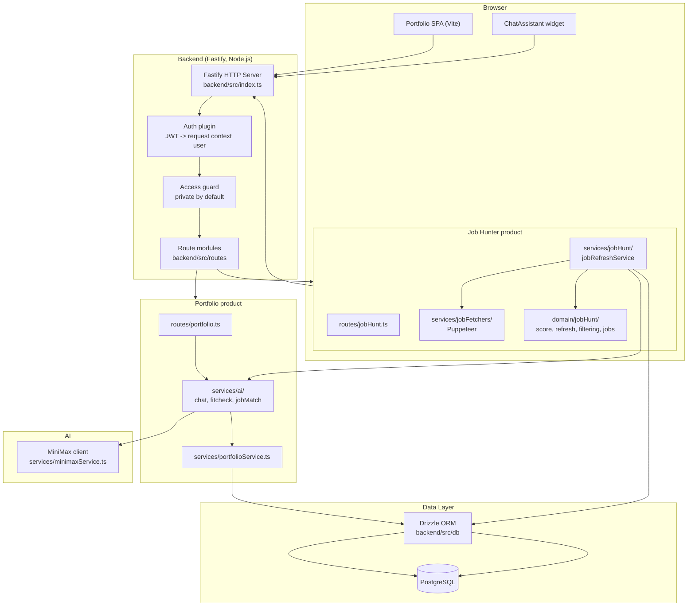
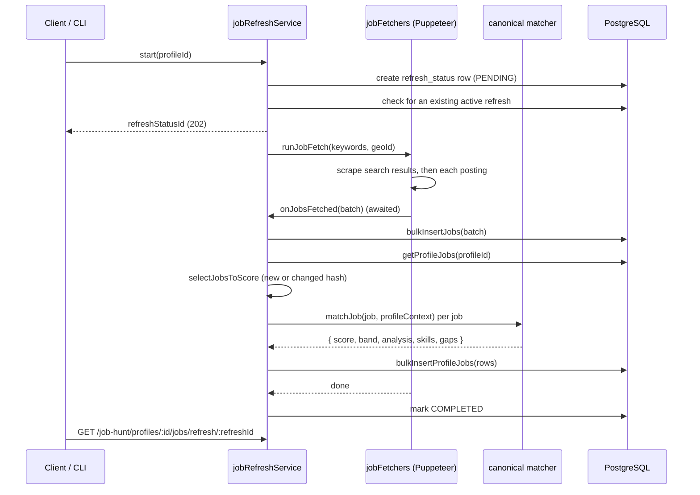

# System Architecture

Six7SWE contains **two products** that share one backend process, one PostgreSQL
database and one AI client, but are kept apart by an explicit boundary.

- **Portfolio** — the public personal site and its AI assistant. Read-only for
  visitors, no authentication.
- **Job Hunter** — a signed-in tool for scraping job postings and scoring them
  against search profiles. Everything it exposes lives under `/job-hunt/*` and
  requires authentication.

The two share exactly one piece of business logic: the canonical job matcher.
Everything else — schema, routes, services, tables — is product-specific.

## High-Level Overview



## The boundary

The boundary is expressed in four places, and all four are checked by tests or
by the compiler.

| Boundary | Where |
|---|---|
| Database tables | `backend/src/db/schema/portfolio.ts` and `backend/src/db/schema/jobHunt.ts` |
| HTTP surface | `/job-hunt/*` vs the public portfolio paths |
| Services | `backend/src/services/ai/` (shared) vs `backend/src/services/jobHunt/` and `backend/src/services/jobFetchers/` |
| Frontend | `/` (public) vs `/hunter/*` (signed in) |

There is no query that joins the two table families, and no service that both
products call except the AI client.

## Authentication & Authorization

Routes are **private by default**. Each route declares whether it is public via
the `public` route config (`backend/src/routes/access.ts`), and the guard in
`backend/src/index.ts` reads that flag off the registered route. Adding an
endpoint therefore cannot accidentally expose it.

```text
Authorization: Bearer <supabase access token>
        │
        ▼
plugins/auth.ts ──► verifies the JWT against the Supabase JWKS endpoint
        │
        ▼
requestContext user { id, email, authId }
        │
        ▼
routes/access.ts ──► private routes require a real user, else 401
```

The verified identity is linked to a local `users` row through
`users.auth_id`. The row is created on first sign-in. `users.id` stays a serial
because `profiles.user_id` references it.

Every job-hunter query that takes a profile id is scoped by the authenticated
user, so a caller cannot reach another user's profile by guessing an id.

> `AUTH_DEV_BYPASS=true` impersonates the seeded user for local development.
> It is refused when `NODE_ENV=production`.

## Frontend

**Stack & location**

- **Framework**: React 18, TypeScript.
- **Bundler**: Vite.
- **Key files**:
  - `frontend/src/main.tsx` – bootstraps the React app.
  - `frontend/src/App.tsx` – routing; the public portfolio and the job-hunter.
  - `frontend/src/components/ChatAssistant.tsx` – floating chat widget.
  - `frontend/src/contexts/AuthContext.tsx` – Supabase session for the job-hunter.
  - `frontend/src/pages/hunter/` – the job-hunter pages.
  - `frontend/src/utils/api.ts` – API client; attaches the access token.

**Routing**

| Route | Rendering |
|---|---|
| `/` | Portfolio landing page (highlights, projects, skills, job matcher, fit check, contact) |
| `/work`, `/contacts` | Redirects into anchors on `/` |
| `/hunter/login` | Sign in |
| `/hunter/profiles` | Search profile list and creation |
| `/hunter/profiles/:id` | Refresh controls and scored matches |
| `/hunter/profiles/:id/edit` | Profile editor |
| `/hunter/knowledge` | Knowledge base (owner only): upload, documents, text preview, "ask as a visitor" playground |

**API communication**

`apiRequest(endpoint, options)` builds the URL from `VITE_API_URL`, falling
back to the `/api` proxy prefix, and attaches the current access token when the
auth context has registered one.

## Backend

**Entry point** — `backend/src/index.ts`:

- Loads environment (`dotenv/config`).
- Creates a Fastify instance with pino logging and header redaction.
- Registers CORS, static file serving from `../public` under `/public/`, and
  `@fastify/request-context`.
- Registers the auth plugin, then the service plugins, then the routes.
- Registers a health check at `/` returning only allowlisted env values.
- Marks abandoned refreshes as failed on startup, then listens.

**Route modules**

| Module | Routes |
|---|---|
| `routes/portfolio.ts` | `GET /portfolio`, `GET /resume`, `POST /chat`, `POST /fitcheck`, `POST /contact` |
| `routes/jobHunt.ts` | `/job-hunt/jobs`, `/job-hunt/profiles` (CRUD), `/job-hunt/profiles/:id/jobs`, `/job-hunt/profiles/:id/jobs/refresh[/:refreshId]`, `/job-hunt/users` |
| `routes/knowledge.ts` | `GET /knowledge/access`; owner only: `/knowledge/documents` (list, upload, get, text, primary, delete), `POST /knowledge/search` |

**AI layer** — `backend/src/services/ai/`:

| Module | Purpose |
|---|---|
| `chat.ts` | Chat assistant, grounded in the portfolio |
| `fitcheck.ts` | First-person fit assessment |
| `jobMatch.ts` | **The canonical matcher.** Profile-source agnostic. |

Prompts live in `backend/src/services/ai/prompts/`. `minimaxService.ts` is
transport only: it sends the request, parses the response and applies the
supplied Zod schema. A malformed model response is an error, never a
fabricated result.

## Data Layer

**Schema** — split by product:

| File | Tables |
|---|---|
| `db/schema/portfolio.ts` | `portfolio_profile` (singleton), `content_sections` |
| `db/schema/jobHunt.ts` | `users`, `profiles`, `jobs`, `profile_jobs`, `refresh_status` |

Enums: `job_source`, `refresh_update_status`, `refresh_update_status_step`,
`match_band`.

**Portfolio service & caching** — `backend/src/services/portfolioService.ts`
reads `portfolio_profile` and `content_sections` through Drizzle and caches the
result in memory for `PORTFOLIO_CACHE_TTL_MS` (default 10 minutes).

## Knowledge Service

`knowledge/` is a separate deployable: Fastify, Drizzle and pgvector. It holds
the owner's professional background (resumes and supporting pdf, md and txt
files) as embedded chunks. It is replacing both the portfolio tables above and
the never-wired `PORTFOLIO_DATA_SOURCE=mcp` path. Full details are in
`knowledge/README.md`.

- **Chat retrieval.** With `PORTFOLIO_DATA_SOURCE=knowledge`, the backend's chat
  context is a compact profile summary (from `portfolio_profile`) plus the top-k
  chunks the service retrieves for the current question and the last user turn
  (`backend/src/data/chatContext.ts`). Retrievals are cached in memory by
  `(corpus_version, normalized question)`
  (`backend/src/services/knowledgeRetrieval.ts`); the version is re-read at most
  every 30 s. The backend refuses to start if the flag is set without
  `KNOWLEDGE_SERVICE_URL` and `KNOWLEDGE_SERVICE_KEY`. If the service fails, chat
  answers from the profile summary alone, and for the next 15 s uncached
  questions skip the service instead of waiting on it again (cached questions
  are still served). The portfolio page, the resume and fitcheck still read
  the portfolio tables. `pnpm --filter @six7swe/backend chat:eval` compares the
  two contexts on the seed eval questions (`backend/src/domain/chatEval/`). Its
  judge's reference is the stuffed context plus the extracted text of every
  knowledge document (read with `KNOWLEDGE_OWNER_KEY`); without that key it is
  the stuffed context only, and the report says so.
- **Shared contract.** The wire contract is the `@six7swe/knowledge-types`
  package (`packages/knowledge-types`), compiled to CommonJS so both the ESM
  service and the CommonJS backend load it. The backend and service builds
  compile it first, and so do their `test` scripts, the backend's `chat:eval`, and the root
  `lint` and `dev` scripts. `pnpm install` does not build it.
- **Schemas.** The service owns the `knowledge` schema, with `documents`,
  `chunks` and `corpus_state`, and keeps its own migration ledger in
  `knowledge_migrations`. Its `schemaFilter`, and the backend's `db:reset`
  dropping only `public` and `drizzle`, keep the two products from managing
  each other's tables.
- **Ingestion.** Ingestion is asynchronous and serial: extract the text, chunk
  it by headings or by windows, embed it, then commit in one transaction.
  Every change bumps `corpus_version`, which callers use as a cache key and a
  staleness signal.
- **Access.** Callers authenticate with the `x-knowledge-key` header, using one
  of two keys: the service key opens only the retrieval routes, and the owner
  key opens only the owner routes (documents and search). On Railway the
  service is private-network only. Raw files live in the private
  `portfolio-files` Storage bucket.
- **Owner gate.** The owner's Knowledge page never calls the service. It calls
  the backend's `/knowledge/*` proxy (`backend/src/routes/knowledge.ts`), which
  verifies the Supabase JWT, requires `sub === OWNER_AUTH_ID` (403 otherwise,
  checked on `onRequest`, before an upload body is read) and forwards the
  request with the owner key, never the user's token. `GET /knowledge/access`
  tells the frontend whether to show the nav entry.
- **Embeddings.** OpenAI `text-embedding-3-small` (1536 dimensions) by
  default, through an OpenAI-compatible client that also works with
  OpenRouter.

## Job Refresh Pipeline



The fetch callback is **awaited**, so `COMPLETED` is only written once the
last batch has actually been scored and stored. Any failure marks the refresh
`FAILED` rather than leaving it `IN_PROGRESS`.

Jobs are re-scored when their content hash changed, so an edited posting is not
left with a stale score forever.

## Domain layer

`backend/src/domain/jobHunt/` holds the pure logic, with no IO and no framework
imports:

| Module | Purpose |
|---|---|
| `score.ts` | Score to band thresholds (`scoreBand`) |
| `refresh.ts` | Refresh status state machine |
| `filtering.ts` | Which jobs still need scoring (`selectJobsToScore`) |
| `jobs.ts` | Search query construction and geoId validation |
| `identity.ts` | Which local row an authenticated subject maps to |

## Environment & Configuration

| Variable | Scope | Purpose |
|---|---|---|
| `DATABASE_URL` | backend | PostgreSQL connection string |
| `MINIMAX_API_KEY` | backend | AI provider key |
| `RESEND_API_KEY` | backend | Contact form delivery |
| `RESEND_FROM_EMAIL` | backend | Sender address for outbound mail |
| `RESEND_FROM_NAME` | backend | Display name for the sender (optional) |
| `PORTFOLIO_CACHE_TTL_MS` | backend | Portfolio cache TTL (default 600000) |
| `SUPABASE_URL` | backend | Auth provider; derives the JWKS endpoint |
| `SUPABASE_JWKS_URL` | backend | Explicit JWKS endpoint (optional) |
| `SUPABASE_JWT_SECRET` | backend | Legacy HS256 mode (optional) |
| `AUTH_DEV_BYPASS` | backend | Dev-only user impersonation |
| `JOB_REFRESH_STALE_MINUTES` | backend | Abandoned refresh threshold (default 30) |
| `OWNER_AUTH_ID` | backend, knowledge | Supabase subject that owns the knowledge base |
| `KNOWLEDGE_URL` | backend | Knowledge service base URL (private network on Railway) |
| `KNOWLEDGE_OWNER_KEY` | backend, knowledge | Owner credential the backend proxy sends to the service |
| `VITE_API_URL` | frontend | Backend base URL |
| `VITE_SUPABASE_URL` | frontend | Supabase project URL |
| `VITE_SUPABASE_ANON_KEY` | frontend | Supabase anon key |

## Deployment Considerations

- **Local development** — run the backend (`pnpm dev`) and the frontend
  (`pnpm dev`); the Vite dev server proxies `/api` to the backend.
- **Production** — build the frontend to `frontend/dist` and serve it from a
  static host or behind a reverse proxy; deploy the backend to Railway with
  `DATABASE_URL` pointing at Supabase's IPv4 connection string.
- **Refreshes** — schedule `pnpm jobs:refresh -- --profile <id>` as a Railway
  Cron so a refresh survives a process restart. The HTTP trigger remains
  available for manual runs.
